# Retail Orders Analysis | Python + SQL

End-to-end data analytics project on **9,994 retail orders (2022–2023)**.
The raw Kaggle file is cleaned with **pandas**, loaded into a **SQLite** database and analysed with **11 SQL queries**.
The results are presented as charts, an **Excel dashboard**, a **PDF report** and a **slide deck**.

**Gaurav Kalamkhede** · Python · pandas · SQL (SQLite) · CTEs and window functions · Matplotlib · Excel · Jupyter

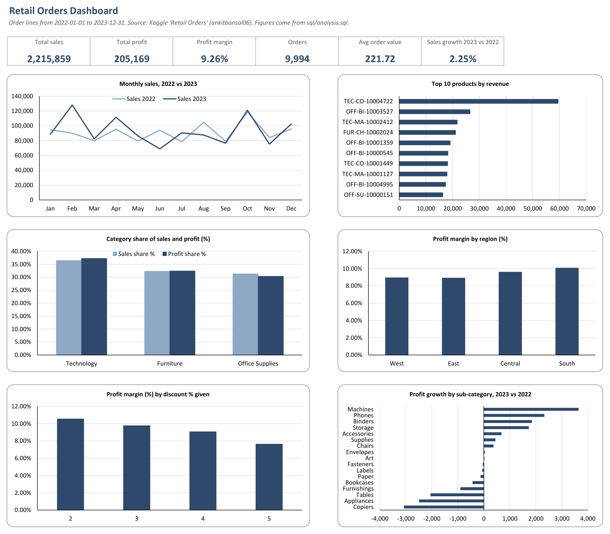

---

## 📌 Start here

| If you want to… | Open | Time |
|---|---|---|
| See the story quickly | [Slides (PDF)](reports/Retail_Orders_Analysis_Slides.pdf) | 2 min |
| Read the full analysis | [Project report (PDF)](reports/Retail_Orders_Analysis_Report.pdf) | 10 min |
| Follow the code step by step | [Jupyter notebook](notebooks/retail_orders_analysis.ipynb) | 15 min |
| Read the SQL | [sql/analysis.sql](sql/analysis.sql) | 5 min |
| Use the dashboard | [Excel dashboard](excel/Retail_Orders_Dashboard.xlsx) (download) | – |
| Understand every step in plain language | [INTERVIEW_PREP.md](INTERVIEW_PREP.md) | 10 min |

## Contents

1. [Results at a glance](#results-at-a-glance)
2. [Key insights and recommendations](#key-insights)
3. [Business questions](#business-questions)
4. [Example query](#example-query)
5. [Charts](#charts)
6. [Data cleaning](#data-cleaning)
7. [Notebook screenshots](#notebook-screenshots)
8. [How the project works](#how-the-project-works)
9. [How to run it](#how-to-run-it)
10. [Acknowledgement](#acknowledgement)

---

## Results at a glance

| KPI | Value |
|---|---|
| Orders analysed | 9,994 (Jan 2022 to Dec 2023) |
| Total sales / total profit | **2,215,859** / **205,169** |
| Profit margin | **9.26%** |
| Average order value | 221.72 |
| Sales 2022 → 2023 | 1,095,590 → 1,120,268 (**+2.25%**) |
| Profit 2022 → 2023 | 101,620 → 103,548 (+1.90%) |
| Top product | TEC-CO-10004722, a copier (59,514 sales, 2.7% of the total) |
| Highest profit growth | **Machines** (+3,635, +50.19%) |
| Best-margin region | South (10.06%) |
| Margin at 2% vs 5% discount | **10.54% vs 7.63%** |
| Loss-making order lines | 3,997 (40%), total loss 3,151 |

## Key insights

1. **Sales grew slowly in 2023 (+2.25%)**, and profit grew a little less (+1.90%), so the margin slipped from 9.28% to 9.24%.
2. **One copier leads everything.** TEC-CO-10004722 sells more than twice the second product and is No. 1 in three of the four regions.
3. **Months are uneven.** February 2023 was 42% above February 2022, but June 2023 was 27% below June 2022. October was a top-two month in both years.
4. **Machines grew profit the most (+50%).** Copiers, Appliances and Tables lost about 7,600 of profit between them.
5. **The West is the biggest region but the only one that shrank** (sales -11.2% in 2023). The South has the best margin but the lowest sales.
6. **Discounts cut margin.** Each extra point of discount lowers the margin by about one point.
7. **40% of order lines lose money.** 3,955 of the 3,997 loss lines have a list price equal to cost, so any discount causes a loss.

### Recommendations

- Do not discount items that are sold at cost. This removes almost all loss-making lines.
- Review the 4% and 5% discount levels, which gave about 51,000 of discount at the lowest margins.
- Find out why the West shrank while every other region grew.
- Keep the top copier in stock and watch its pricing, since one product brings 2.7% of sales.
- Check pricing, costs and product mix for Copiers, Appliances and Tables.

---

## Business questions

| # | Question | SQL technique |
|---|---|---|
| Q1 | Top 10 products by revenue | `GROUP BY`, `ORDER BY`, `LIMIT` |
| Q2 | Top 5 products in each region | CTE + `ROW_NUMBER() OVER (PARTITION BY region)` |
| Q3 | Month-over-month sales, 2022 vs 2023 | `CASE WHEN` pivot, `strftime()` |
| Q4 | Highest-sales month for each category | CTE + `ROW_NUMBER()` |
| Q5 | Sub-category with the highest profit growth, 2023 vs 2022 | conditional `SUM` |
| Q6 | Year-to-date running total of sales | `SUM() OVER (PARTITION BY year ORDER BY month)` |
| Q7 | Category share of revenue and profit | `SUM(SUM(x)) OVER ()` |
| Q8 | Sub-categories ranked by profit within category | `DENSE_RANK()` |
| Q9 | Regional profitability and growth | CTE + `RANK()` |
| Q10 | Segment profitability and average order value | `COUNT(DISTINCT)`, ratios |
| Q11 | Discount impact on profit margin | `GROUP BY discount_percent` |

Q1 to Q5 are the questions from the tutorial. Q6 to Q11 are my extensions. Every query's result is saved in [outputs/sql_results/](outputs/sql_results).

## Example query

Top 5 products in each region (Q2). A CTE totals sales per region and product, then `ROW_NUMBER()` ranks products inside each region:

```sql
WITH region_product AS (
    SELECT region, product_id, SUM(sale_price) AS sales
    FROM df_orders
    GROUP BY region, product_id
),
ranked AS (
    SELECT region, product_id, sales,
           ROW_NUMBER() OVER (PARTITION BY region ORDER BY sales DESC) AS rn
    FROM region_product
)
SELECT region, rn AS rank_in_region, product_id, ROUND(sales, 2) AS sales
FROM ranked
WHERE rn <= 5
ORDER BY region, rn;
```

| region | rank | product_id | sales |
|---|---|---|---|
| Central | 1 | TEC-CO-10004722 | 16,975.0 |
| East | 1 | TEC-CO-10004722 | 29,099.0 |
| South | 1 | TEC-MA-10002412 | 21,734.4 |
| West | 1 | TEC-CO-10004722 | 13,440.0 |

*(Rank 1 rows shown; the full result has 5 rows per region.)*

---

## Charts

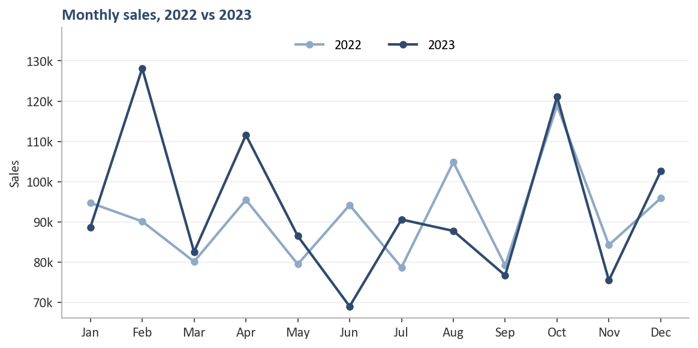

| | |
|---|---|
| 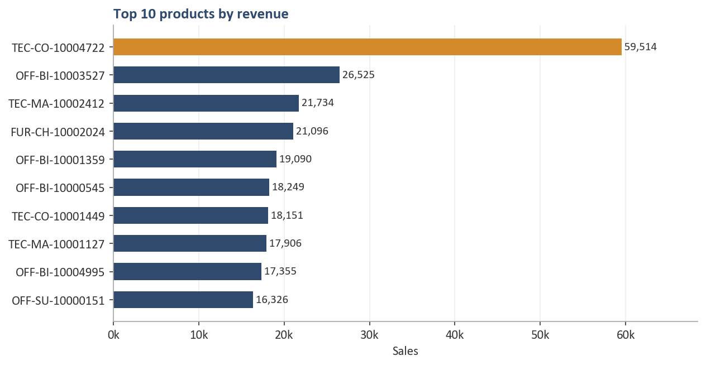 | 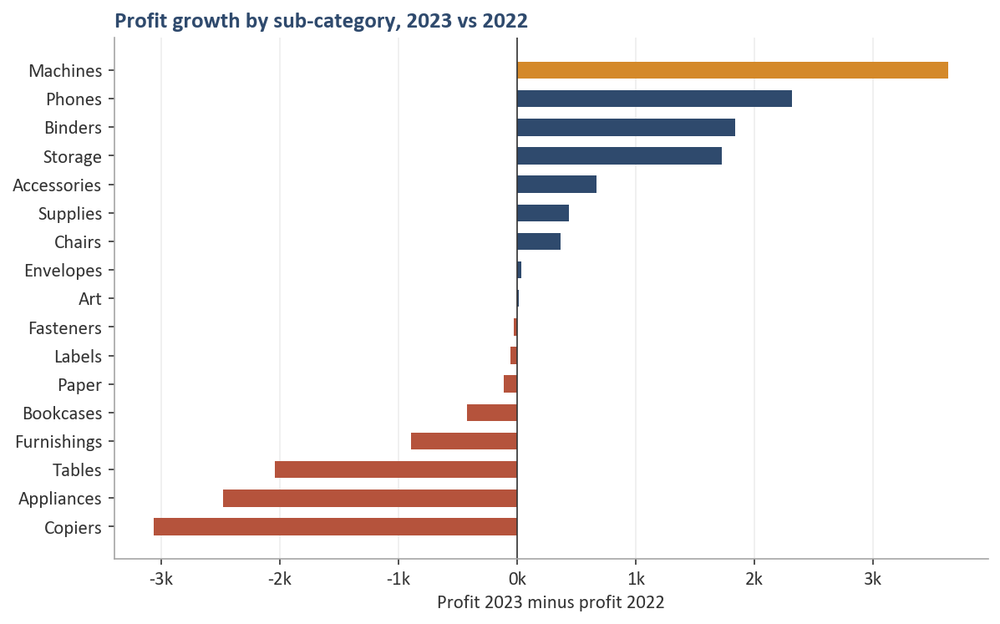 |
| 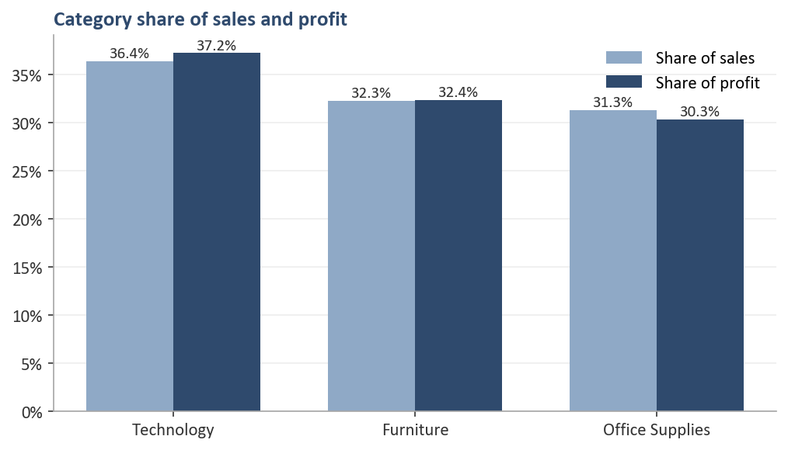 | 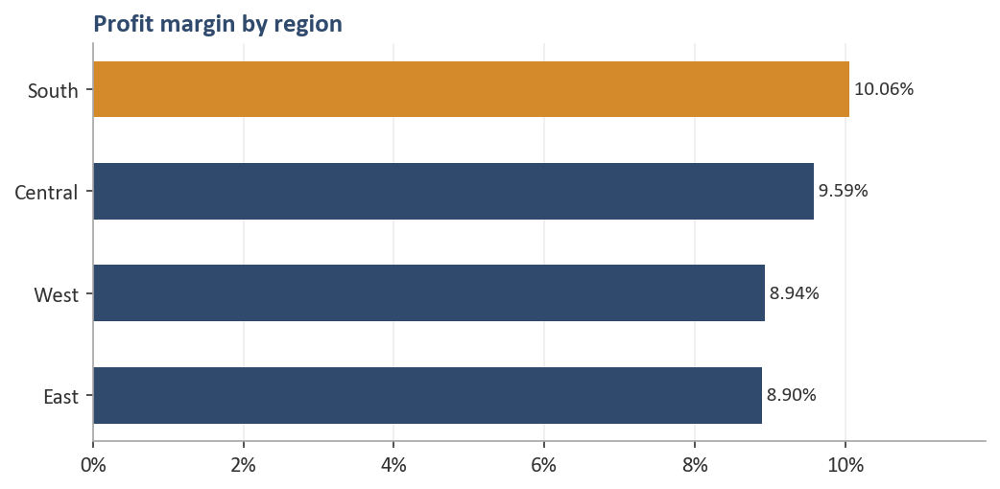 |
| 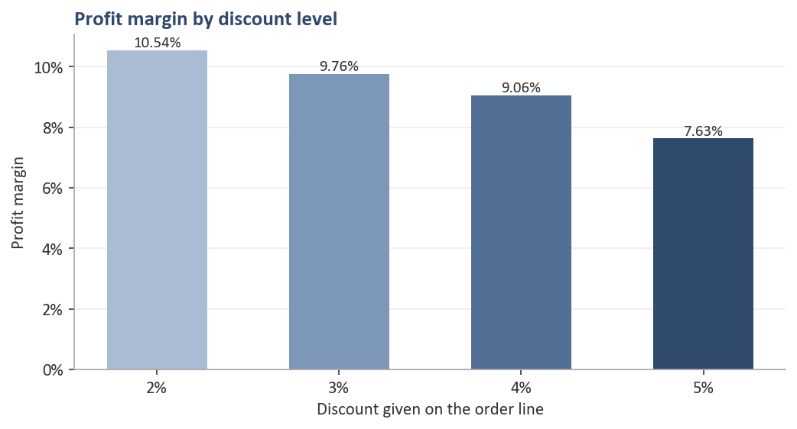 | 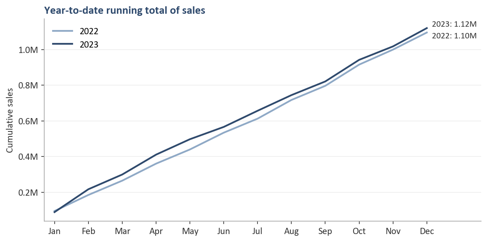 |

Navy is the main colour, steel blue is used for comparisons, and amber highlights the answer in each chart.

---

## Data cleaning

| Step | Why |
|---|---|
| Read with `na_values=['Not Available', 'unknown']` | Missing ship modes were written as words, so pandas would have counted them as real ship modes (6 rows). |
| Rename columns to snake_case | Headers like `cost price` and `Order Id` have spaces and mixed case, which are awkward in pandas and SQL. |
| Add `discount`, `sale_price`, `profit` | The file only has list price, cost price and discount %. Revenue and profit have to be calculated. |
| Convert `order_date` to a date | It was read as text, so year and month could not be extracted reliably. |
| Drop `list_price` and `cost_price` | They are captured by the new columns. I keep `discount_percent` for the discount analysis (Q11). |

`list_price` is the line total before discount, so revenue is the sum of `sale_price`; there is no need to multiply by quantity.
The notebook checks that SQL and pandas give exactly the same totals.

## Notebook screenshots

**Reading the raw file:** `na_values` turns 'Not Available' and 'unknown' into proper missing values.

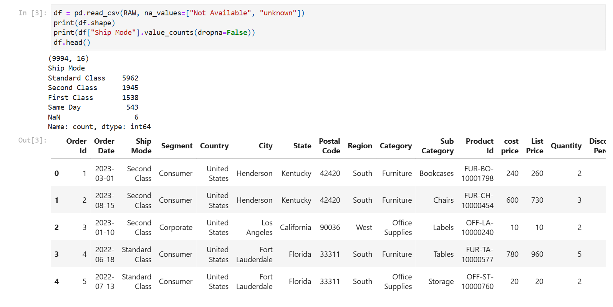

**Checks after cleaning:** no rows lost, no duplicate orders, and the loss-making lines found.

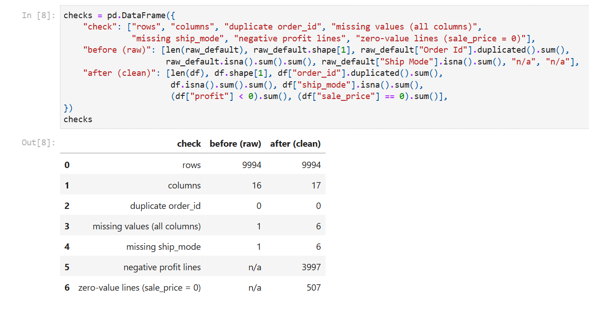

**A SQL result in the notebook (Q5):** sub-categories by profit growth.

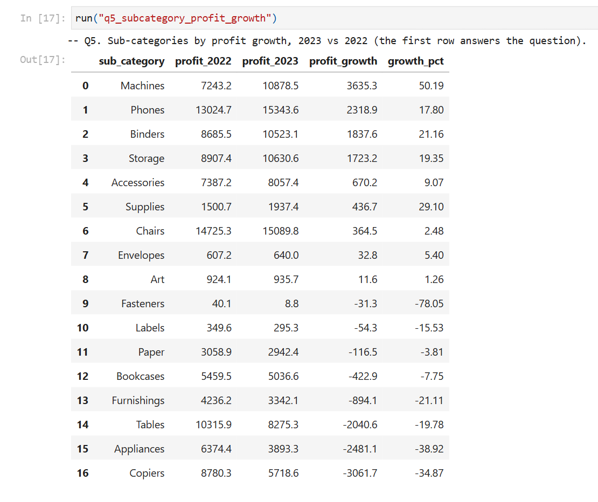

---

## How the project works

```
data/raw/orders.csv          raw Kaggle file (you download it)
        │  pandas: na_values, snake_case, discount / sale_price / profit, dates, drop columns
        ▼
data/processed/orders_clean.csv
        │  to_sql
        ▼
data/retail_orders.db        SQLite table df_orders
        │  sql/analysis.sql  (11 queries)
        ▼
outputs/sql_results/*.csv ─► outputs/kpis.json ─► outputs/charts/*.png
        │
        ├─► excel/Retail_Orders_Dashboard.xlsx
        ├─► reports/Retail_Orders_Analysis_Report.pdf
        └─► reports/Retail_Orders_Analysis.pptx (+ PDF copy)
```

### Repository structure

```
Retail-Orders-Analysis/
├── data/raw/                  put orders.csv here (not committed)
├── notebooks/
│   └── retail_orders_analysis.ipynb   step-by-step walkthrough, executed with outputs
├── sql/
│   └── analysis.sql           all 11 queries
├── src/
│   ├── pipeline.py            cleaning → SQLite → SQL results → KPIs → charts
│   ├── excel_dashboard.py     builds the Excel dashboard
│   ├── build_report.py        builds the PDF report
│   └── build_deck.py          builds the PowerPoint deck
├── outputs/
│   ├── kpis.json              headline numbers
│   ├── sql_results/           one CSV per query
│   └── charts/                PNG charts
├── excel/                     Excel dashboard
├── reports/                   PDF report, slides (PPTX and PDF)
├── images/                    notebook and dashboard screenshots
├── INTERVIEW_PREP.md          plain-language explanations and interview questions
├── requirements.txt
└── LICENSE
```

---

## How to run it

1. Download `orders.csv` from the Kaggle dataset [Retail Orders](https://www.kaggle.com/datasets/ankitbansal06/retail-orders) and save it as `data/raw/orders.csv`.
2. Install the packages:
   ```bash
   pip install -r requirements.txt
   ```
3. Run the pipeline. It creates the clean CSV, the SQLite database, the SQL results, the KPIs and the charts:
   ```bash
   python src/pipeline.py
   ```
4. Open the notebook to follow each step: `notebooks/retail_orders_analysis.ipynb`.
5. Optional: rebuild the Excel dashboard, report and deck.
   ```bash
   python src/excel_dashboard.py
   python src/build_report.py
   python src/build_deck.py
   ```
   The PDF report is printed with Microsoft Edge through Playwright (`channel="msedge"`).

## Tools

Python 3.13 · pandas · SQLite (`sqlite3`) · Matplotlib · Jupyter · openpyxl · python-pptx · Playwright

## Acknowledgement

This project follows the flow and the five core business questions of **Ankit Bansal's** YouTube tutorial
[End to End Data Analytics Project (Python + SQL)](https://www.youtube.com/watch?v=uL0-6kfiH3g)
and uses his [Retail Orders dataset on Kaggle](https://www.kaggle.com/datasets/ankitbansal06/retail-orders).
The code was written fresh for this project rather than copied from the tutorial, and it uses SQLite instead of SQL Server.
I added the extra SQL analysis (Q6 to Q11), the checks, the charts, the Excel dashboard, the report and the deck.

## Author

**Gaurav Kalamkhede** – aspiring data analyst · [GitHub @gauravkal006](https://github.com/gauravkal006)

Also see my [Customer Churn Analysis](https://github.com/gauravkal006/Customer-Churn-Analysis) project.

## License

[MIT](LICENSE)
